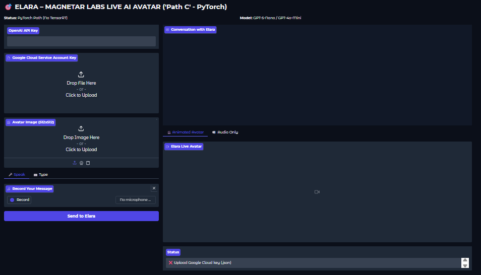
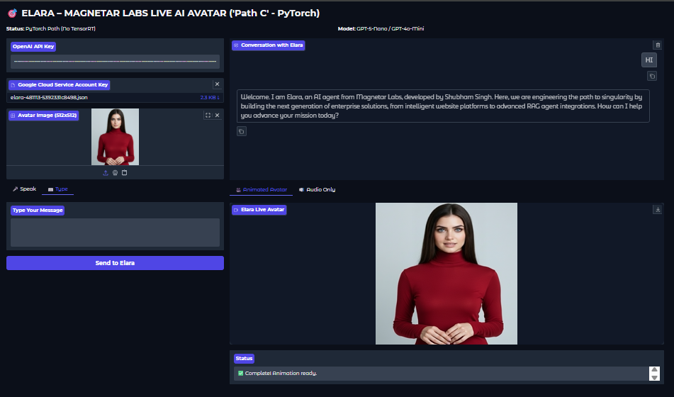
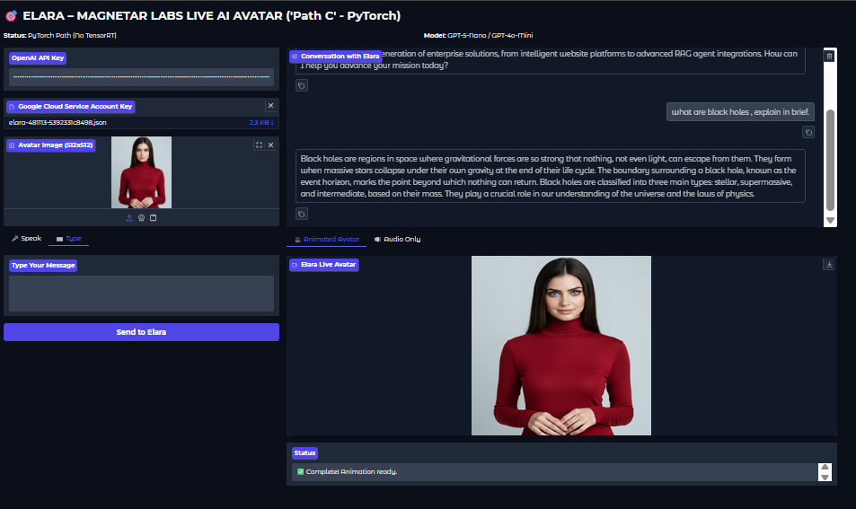

# ELARA-Agentic-Avatar 🎥🧠
A Resource-Aware, Multimodal AI Avatar & Agent Orchestration System

---

## 📖 Overview

**ELARA-Agentic-Avatar** is an end-to-end multimodal AI system that integrates **speech recognition, large language model reasoning, neural text-to-speech, and talking-head animation** into a single agentic interface.

This project is **not a UI mock**, **not a talking-head demo**, and **not a single-model showcase**.

It demonstrates how a **live AI avatar agent** can be engineered to operate **reliably under strict resource constraints (such as Google Colab)** while preserving a clean architectural upgrade path to **real-time, TensorRT-accelerated deployments**.

ELARA is designed as an **applied AI systems artifact** within `ai-systems-lab`, complementing Magnetar Labs’ broader work across agentic intelligence, RAG systems, and sovereign AI architectures.

---

## 🧠 What This System Does

ELARA enables a user to:

- Speak **or** type a query
- Convert speech → text using **Google Speech-to-Text**
- Generate a structured response using **OpenAI LLMs**
- Convert the response to natural speech using **Google WaveNet TTS**
- Animate a photorealistic avatar using a **PyTorch-native talking-head pipeline**
- Gracefully fall back to **audio-only output** if animation fails

All outputs shown below are **real system executions**, not simulated screens or curated demos.

---

## 🛡️ Design Principles

### ✅ Resource-Aware Engineering
- Designed to run under **GPU, memory, and runtime constraints**
- Fully functional on **Google Colab**
- No silent dependency failures

### ✅ Explicit Control & Transparency
- API keys are **user-provided only**
- No background calls
- No hidden inference layers

### ✅ Architecture Before Optimization
- Correctness, portability, and reproducibility prioritized
- Performance acceleration treated as a **deployment-time decision**

---

## 🚀 Key Capabilities

- Multimodal interaction (voice + text)
- Agent-style LLM orchestration
- Neural TTS with consistent voice identity
- PyTorch-native avatar animation
- ONNX auxiliary model validation
- Graceful degradation under failures
- Clear separation of inference stages

---

## 🧠 Why **Path C (PyTorch-Native)** Was Chosen

TensorRT enables **near real-time avatar animation**, but it requires:

- Additional GPU memory
- Stable CUDA + TensorRT availability
- Engine compilation
- Hardware consistency not guaranteed in shared environments

**Google Colab is a resource-constrained and unstable environment** for TensorRT-based pipelines.

To ensure:
- End-to-end feasibility
- Reproducibility by other users
- Checkpoint integrity
- Reliable execution without specialized acceleration

This project **intentionally adopts Path C (PyTorch-native)**.

While this introduces **visible animation latency**, it allows the **entire multimodal pipeline** (STT → LLM → TTS → animation) to execute **correctly and verifiably** under constrained infrastructure.

> **TensorRT is treated as a performance optimization layer, not a system dependency.**

The architecture remains **fully compatible with TensorRT** for future high-performance deployments.

---

## 🧠 System Architecture

**Speech-to-Text → LLM Agent → Text-to-Speech → Avatar Animation (Path C)**

Auxiliary ONNX models are **validated at runtime** to ensure Git-LFS checkpoint integrity.

---

## 🛠 Tech Stack

- **Language:** Python  
- **UI Framework:** Gradio  
- **LLMs:** OpenAI (explicit, user-provided API key)  
- **Speech-to-Text:** Google Cloud Speech  
- **Text-to-Speech:** Google Cloud WaveNet  
- **Animation:** PyTorch-native Ditto talking-head pipeline  
- **ONNX Runtime:** Auxiliary model execution  
- **Media Processing:** FFmpeg  

---

## 📂 Project Structure

ELARA-Agentic-Avatar/
│── elara.py
│── blackhole_animation.mp4
│── blackhole_explaination.png
│── interface_modular.png
│── welcome_note_1.png
│── welcome_note_animation.mp4
│── README.md


---

## 🧪 Step-by-Step System Demonstration

### 1️⃣ Modular Agent Interface

Core ELARA interface showing API inputs, voice/text options, and execution flow.



---

### 2️⃣ Welcome Agent Initialization

System-initiated agent introduction using avatar animation.




---

### 3️⃣ Live Knowledge Explanation (Avatar Output)

Avatar explaining a scientific concept with synchronized speech and animation.




---

## ⚠️ Limitations & Disclosure

### Performance
- PyTorch animation introduces perceptible latency
- Real-time animation requires TensorRT + higher resources

### Infrastructure
- Designed for Colab survivability
- Not tuned for ultra-low-latency streaming

### Outputs
- No smoothing
- No post-processing
- No curated demos

All media reflects **actual system behavior**.

---

## ▶️ Usage

```bash
python elara.py
```
Follow the UI steps to:

Provide API keys

Choose voice or text input

Generate agent response

View avatar animation or audio fallback

🔮 Future Enhancements
TensorRT acceleration mode

Streaming animation

Persistent agent memory

RAG-backed knowledge grounding

Multi-avatar support

Enterprise authentication

Non-Colab deployments

👨‍💻 Author
Shubham Singh
Magnetar Labs

📜 License
MIT License
