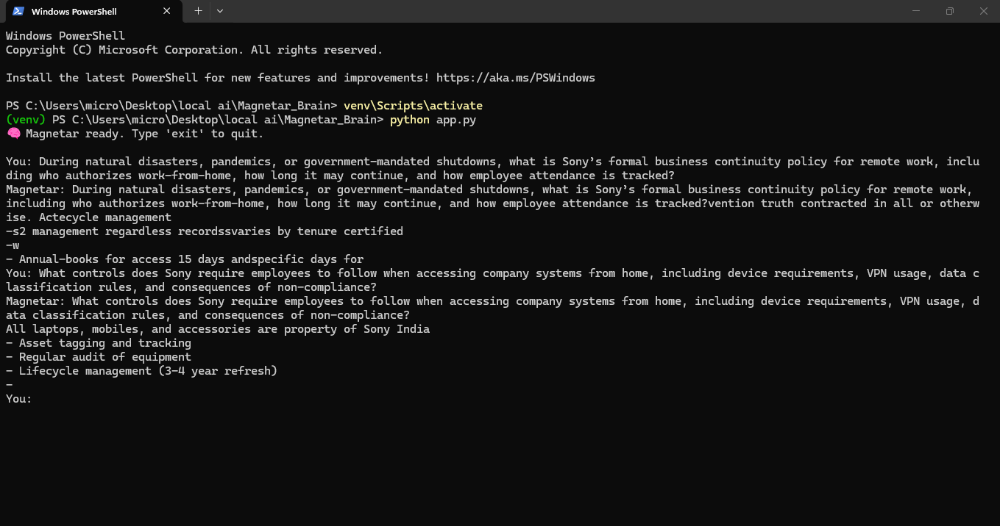

# MAGNETAR-SOVEREIGN 🧠⚡  
**A Self-Built, Offline, Sovereign Language Intelligence System**

---

## 📖 Overview

**MAGNETAR-SOVEREIGN** is a **self-authored GPT-class language intelligence system** built entirely from first principles using PyTorch.

This project is **not a wrapper**, **not API-dependent**, and **not fine-tuned from any proprietary cloud model**.  
The system is designed to **train, retrieve, reason, and respond locally**, preserving **data sovereignty, execution transparency, and architectural control**.

MAGNETAR-SOVEREIGN demonstrates how modern language intelligence can be engineered as a **standalone system**, rather than consumed as a hosted service.

---

## 🛡️ Why “Sovereign”?

MAGNETAR-SOVEREIGN qualifies as **sovereign AI** due to the following technical and architectural properties:

### ✅ Fully Offline Execution
- No external inference APIs
- No cloud calls
- No telemetry or hidden network usage
- All inference runs **locally on the host machine**

### ✅ Self-Built Transformer Architecture
- Custom GPT-style **causal transformer**
- Hand-written attention, MLP, residual blocks
- Explicit architectural configuration (layers, heads, embeddings)
- No `AutoModel`, no black-box loaders

### ✅ Self-Owned Training Pipeline
- Custom data ingestion engine
- Deterministic seed control
- Native PyTorch training loop
- Gradient clipping, AMP, validation, and HPO
- No hosted training services

### ✅ Data Sovereignty
- Trained on **locally owned JSON corpora**
- No data leaves the system
- No vendor visibility into documents
- Suitable for **policy, compliance, and internal knowledge bases**

### ✅ Transparent Outputs
- No reranking
- No post-processing
- No answer rewriting
- Outputs reflect **true model behavior under real constraints**

> **Sovereign ≠ bigger**  
> **Sovereign = owned, inspectable, controllable**

---

## 🚀 Key Capabilities

- GPT-class causal language modeling
- Structured policy and document ingestion
- Multi-turn conversation learning
- Assessment-style Q&A understanding
- Local semantic memory vault (vector embeddings)
- Deterministic inference behavior
- Zero external dependency at runtime

---

## 🧠 System Architecture

### Core Components

- **Magnetar-Sovereign Core**
  - Causal self-attention transformer
  - Residual + LayerNorm architecture

- **Quantum Data Engine**
  - Policy-aware JSON ingestion
  - Multi-format semantic flattening

- **Global Vault**
  - Dense embeddings (BGE-Large)
  - Local vector storage (`.npy`)

- **Inference Shell**
  - CLI-based interaction
  - No UI abstraction or filtering

---

## 🛠 Tech Stack

- **Framework:** PyTorch  
- **Architecture:** Custom GPT-style Transformer  
- **Tokenizer:** GPT-2 tokenizer (locally extended)  
- **Embeddings:** BAAI / BGE-Large  
- **Training:** Native PyTorch (AdamW, AMP, clipping)  
- **Runtime:** CPU-only (GPU optional)

---

## 📂 Project Structure

MAGNETAR-SOVEREIGN/
│── app.py # Local inference shell
│── model.py # Transformer architecture
│── self_made_gpt_local.py # Training + data engine
│── sony_json.json # Sample policy corpus
│── output.png # Real, unfiltered output
│── README.md # Documentation


---

## ⚠️ Model Limitations & Output Disclosure

The current outputs should be interpreted in the context of the system’s execution constraints.

### Small Dataset
The model is operating on a limited policy corpus, which restricts retrieval depth and cross-section coverage.  
As a result, certain sections may be over-represented when semantically dense content dominates the dataset.

### CPU-Only Inference
The system is running entirely on a CPU-based device (laptop environment) without GPU acceleration. This leads to:
- Slower inference times
- Reduced practical context window usage
- Conservative decoding to avoid latency spikes

### No Fine-Tuning or Reranking
The model is used in a **pure inference + retrieval setup**, without:
- Domain fine-tuning
- Cross-encoder reranking
- Intent-aware routing

This is intentional to preserve transparency of raw model behavior.

### Real, Unfiltered Outputs
All responses shown are **direct model outputs** with:
- No post-processing
- No summarization
- No manual correction

Any repetition or partial coverage reflects **true system behavior**, not demo manipulation.

---

## ▶️ Usage

```bash
python app.py
You will see:

🧠 Magnetar ready. Type 'exit' to quit.
Ask natural language questions directly against the trained corpus.
```
🖼 Demo Output
Unaltered, real system output generated during local inference
(CPU-only execution, no reranking, no post-processing)




This output is shown exactly as produced by MAGNETAR-SOVEREIGN during local CPU inference.

🔮 Future Enhancements
GPU acceleration

Cross-encoder reranking (optional)

Intent-aware routing

Extended memory hierarchies

Multi-agent orchestration

Formal evaluation benchmarks

👨‍💻 Author
Shubham Singh
Self-Built Systems · Applied AI · Sovereign Architectures

📜 License
MIT License

