# MAGNETAR-WEBSTACK 🌐☁️  
**An AI-Powered Website Generation, Document-Grounded RAG, and GCP Deployment System**

---

## 📖 Overview

**MAGNETAR-WEBSTACK** is an end-to-end AI system that generates complete static websites from natural language instructions, optionally embeds a **document-grounded Retrieval-Augmented Generation (RAG) assistant**, and deploys the resulting website directly to **Google Cloud Platform (GCP)**.

This project is **not a UI mock**, **not a static template**, and **not a shallow RAG demo**.  
It demonstrates how AI systems can be engineered to combine **content generation, document-faithful intelligence, and real cloud deployment**—while preserving **explicit user control, data boundaries, and deployment transparency**.

MAGNETAR-WEBSTACK is designed as an **applied AI systems project**, complementing (but remaining independent from) the core **MAGNETAR-SOVEREIGN** language intelligence system.

---

## 🧠 What This System Does

MAGNETAR-WEBSTACK enables a user to:

1. Describe a website in natural language  
2. Generate a complete, styled static website (`index.html`)
3. Optionally attach an **inbuilt RAG bot** that answers questions **strictly from uploaded documents**
4. Require an API key **only at the moment of querying**
5. Package the site as a downloadable ZIP
6. Deploy the site to **GCP static hosting**

All of the above are demonstrated with **real outputs**, not simulated screens.

---

## 🛡️ Design Principles

### ✅ Explicit User Control
- RAG is **opt-in**
- Cloud deployment is **opt-in**
- API key is requested **only when the bot is used**
- No background inference or silent calls

### ✅ Document-Faithful RAG
- The bot answers **only from uploaded documents**
- No fallback to general knowledge
- No hallucinated policy answers

### ✅ Static + Cloud Friendly
- Output is a pure static website
- Works locally and after cloud deployment
- No backend required after deployment

---

## 🚀 Key Capabilities

- AI-driven static website generation
- Optional document-grounded RAG assistant
- Client-side API key usage
- Policy-faithful question answering
- Static ZIP packaging
- One-click GCP deployment (bucket-based)
- Works for internal policy sites, demos, and AI product pages

---

## 🧠 System Architecture

### Core Components

**Website Generator**
- Converts natural-language instructions into structured HTML
- Produces a complete `index.html` with navigation, sections, and styling

**Document RAG Engine**
- Accepts PDF / DOCX / TXT / MD / HTML documents
- Performs chunking and embedding
- Retrieves only semantically relevant sections
- Generates answers strictly grounded in retrieved content

**Deployment Layer**
- Packages website artifacts
- Uploads to an existing GCP bucket
- Preserves client-side RAG behavior post-deployment

---

## 🛠 Tech Stack

- **Language:** Python
- **UI Framework:** Gradio
- **LLM Access:** OpenAI (explicit, user-provided API key)
- **Embeddings:** Single-model embedding space (dimension-safe)
- **Vector Search:** In-memory cosine similarity
- **Cloud:** Google Cloud Platform (Static Bucket Hosting)
- **Output:** Static HTML + ZIP

---

## 📂 Project Structure

MAGNETAR-WEBSTACK/
│── websitecreation+rag+gcpdeployment.py # Core system logic
│── Sony Bangalore Office Policy Creation.docx
│── Interface.jpeg
│── full_interface.jpeg
│── interface_withrag_selected.jpeg
│── RAG_api_keypopup.jpeg
│── rag_output.jpeg
│── ragoutput_verification.jpeg
│── clouddeployment_selected.jpeg
│── cloud_bucket_deployed.jpeg
│── cloud_rag_working.jpeg
│── cloud_rag_verification.jpeg
│── websitecreated_output.jpeg
│── website_generated_withrag.jpeg
│── website_cloud.jpeg
│── full_website.jpeg
│── README.md


---

## 🧪 Step-by-Step System Demonstration

### 1️⃣ Core Interface

Initial system interface for website creation, RAG selection, and deployment options.

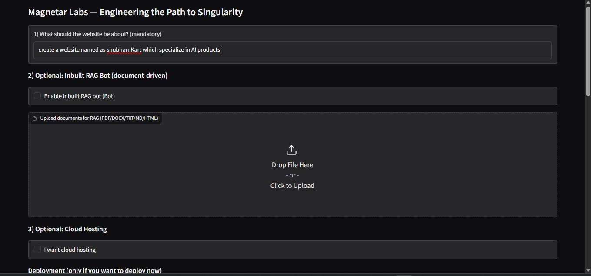

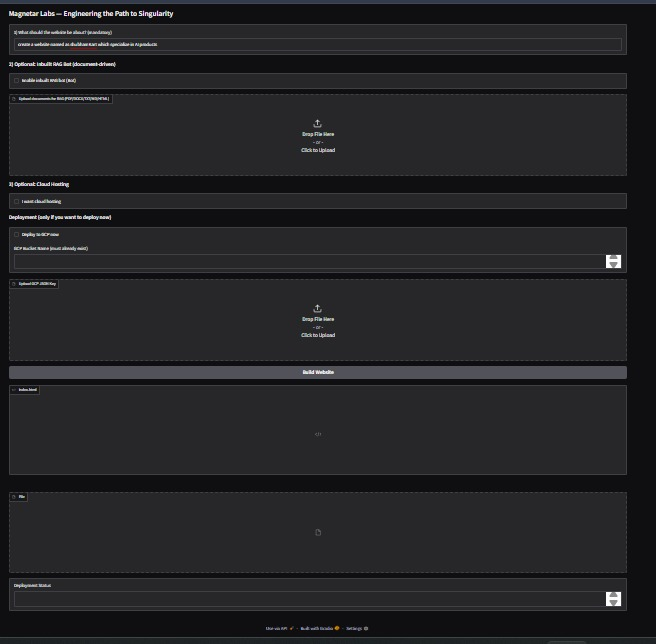

---

### 2️⃣ Enabling Document-Grounded RAG

RAG can be explicitly enabled and documents uploaded.

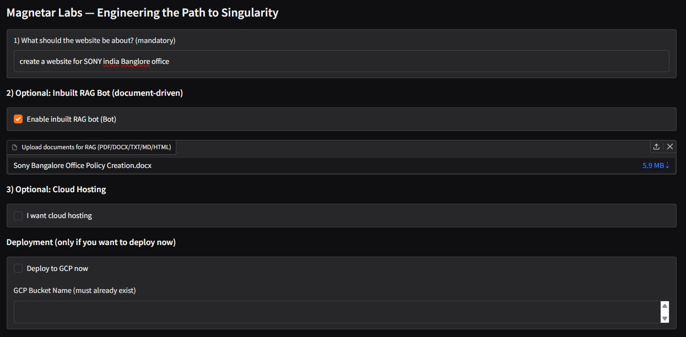

---

### 3️⃣ API Key Prompt (Explicit & On-Demand)

The API key is requested **only when the RAG bot is used**, and only in the browser.

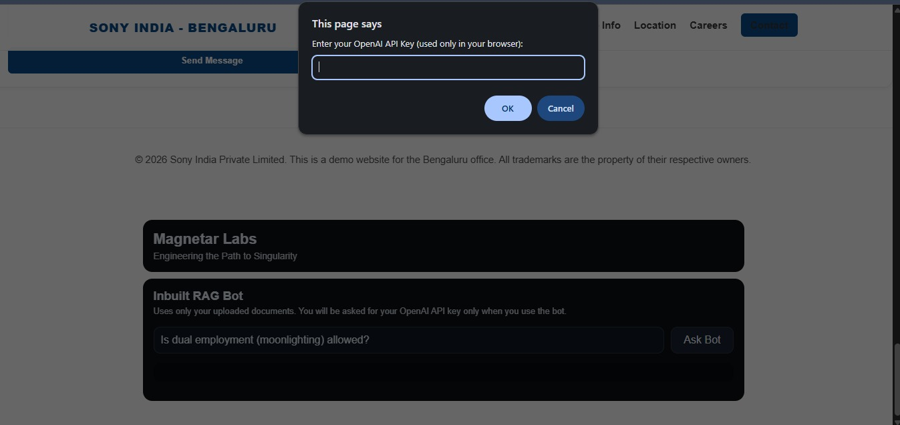

---

### 4️⃣ RAG Answer Output (Raw)

Example question asked against the uploaded policy document.

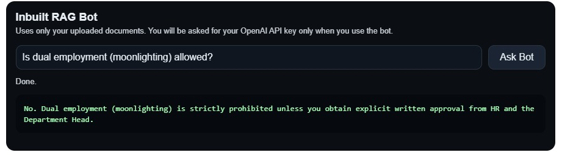

---

### 5️⃣ RAG Answer Verification Against Source Document

The model’s answer matches the exact policy clause from the uploaded document.

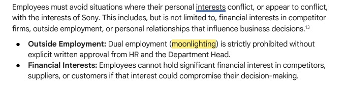

---

### 6️⃣ Cloud Deployment Selection

Deployment to GCP is an explicit user choice.


---

### 7️⃣ Successful GCP Bucket Deployment

The generated website is deployed to an existing GCP bucket.

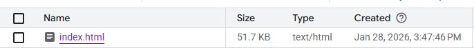

---

### 8️⃣ RAG Working After Cloud Deployment

The RAG bot continues to function correctly **after deployment**.


---

### 9️⃣ Cloud RAG Verification

Policy-faithful answers remain consistent post-deployment.

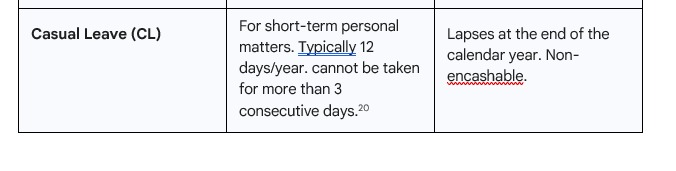

---

### 🔟 Website Generation Output

Generated static website output (local).

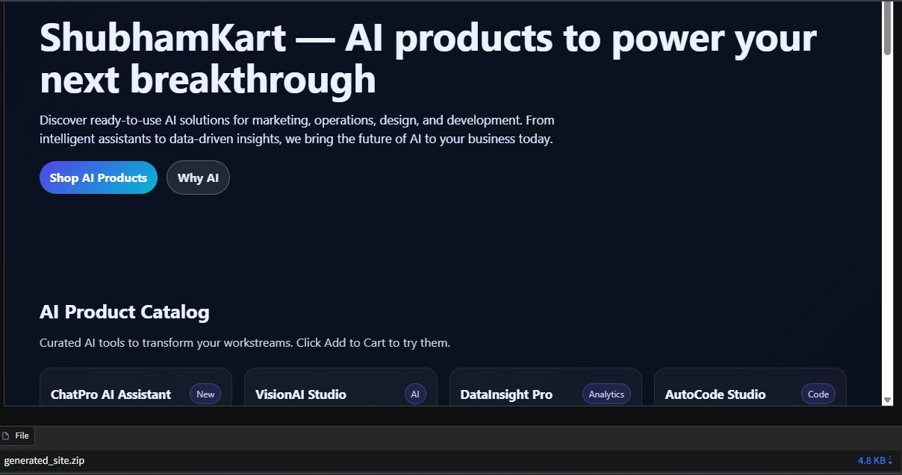


---

### 1️⃣1️⃣ Website Live on Cloud

Deployed website running on GCP.

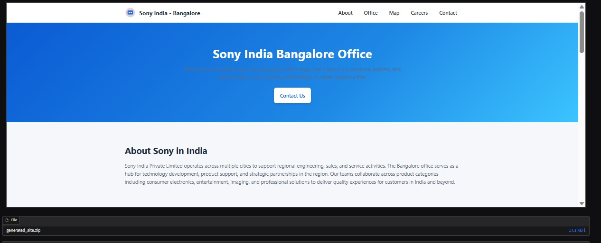

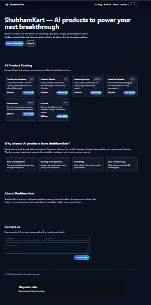

---

## ⚠️ Limitations & Disclosure

### API Dependency
- LLM access requires a user-provided API key
- Keys are never stored or reused

### No Reranking
- Retrieval uses direct cosine similarity
- No cross-encoder reranking layer

### Static Hosting Constraints
- No server-side memory
- RAG remains client-triggered

### Real, Unfiltered Outputs
- No answer rewriting
- No summarization
- No hidden corrections

All screenshots reflect **actual system behavior**, not curated demos.

---

## ▶️ Usage

```bash
python websitecreation+rag+gcpdeployment.py
Follow the UI steps to:

Describe the website

Upload documents (optional)

Enable RAG (optional)

Deploy to GCP (optional)

🔮 Future Enhancements
Multi-document routing

Source citations in answers

Optional reranking layer

Support for AWS / Azure static hosting

Website theming controls

Enterprise authentication layer

👨‍💻 Author
Shubham Singh


📜 License
MIT License
