🛡️ MCP-AGENTIC-CONTROL-LAB

Comparative Agentic RAG Architectures: MCP-Style vs MCP-Native Control

📖 Overview

MCP-AGENTIC-CONTROL-LAB is a systems-engineering project that demonstrates two complete, working implementations of a role-based, document-grounded Retrieval-Augmented Generation (RAG) system—built using two fundamentally different control paradigms:

MCP-Style RAG (UI-Orchestrated Control)

MCP-Native RAG (Agent → Tool → Context Control)

Both systems solve the same enterprise problem:

Policy document ingestion

Role-based access control (Admin / User / Unknown)

Secure policy updates

Faithful, non-hallucinated answers

Safe handling of missing information

The purpose of this repository is not to show “another RAG chatbot”.

It exists to answer a deeper systems question:

Where should authority, trust, and control live in an agentic AI system?

🧠 What This Repository Demonstrates

This repository intentionally contains two implementations side-by-side to demonstrate architectural trade-offs, not redundancy.

You will see:

The same policy Q&A problem solved in two ways

The same outputs achieved through different control flows

Clear evidence of:

Authorization success

Authorization failure

Post-update retrieval correctness

Safe failure modes (no hallucinations)

All screenshots are real system outputs, captured during execution.

🏗️ Architectural Variants
1️⃣ MCP-Style RAG (UI-Orchestrated)

📄 File: mcp_inspired_rag.py

Control Flow

User → UI → Application Logic → Vector Store → LLM → UI

Key Characteristics

Role enforcement handled in the UI / app layer

Admin vs User decisions occur before LLM interaction

LLM is passive and unaware of authorization failures

Evaluation metrics layered externally

Best suited for

Internal dashboards

Rapid demos

Human-controlled workflows

2️⃣ MCP-Native RAG (Agent-Tool Orchestrated)

📄 File: mcp_native.py

Control Flow

User → Agent (LLM) → Tool Call → Context → Agent (LLM) → UI

Key Characteristics

Authorization enforced inside tools

Agent is explicitly aware of:

Authorization failure

Missing context

Tool outcomes

Designed for auditability and extensibility

Aligns with Model Context Protocol (MCP) principles

Best suited for

Policy engines

Regulated systems

Multi-agent platforms

🛡️ Design Principles

✅ Explicit Authority Placement
Authority is deliberately placed either in the UI (MCP-Style) or in tools (MCP-Native).

✅ Document-Faithful RAG
Answers are generated strictly from retrieved document context.

✅ Safe Failure Modes
When information is missing, the system responds safely instead of hallucinating.

✅ Evidence-First Demonstration
All screenshots reflect real executions, not curated demos.

🧪 Step-by-Step Demonstration (MCP-Style RAG)
1️⃣ System Interface (MCP-Style)
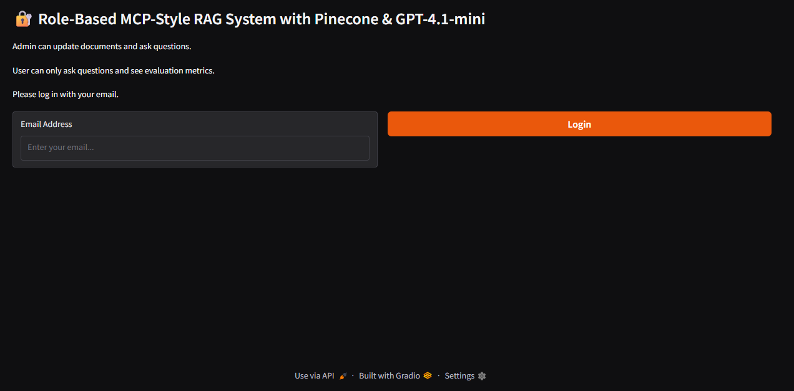
2️⃣ Admin Dashboard Interface
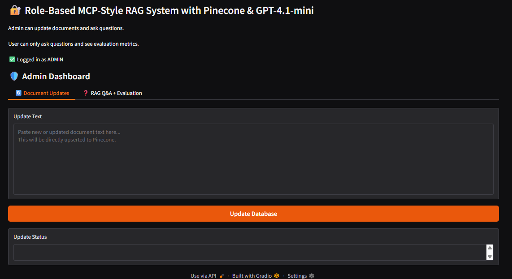
3️⃣ User Dashboard Interface
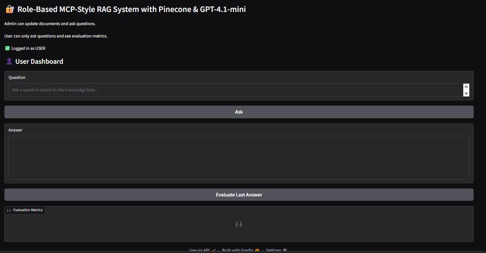
4️⃣ Unknown Email Denied (Access Control Proof)
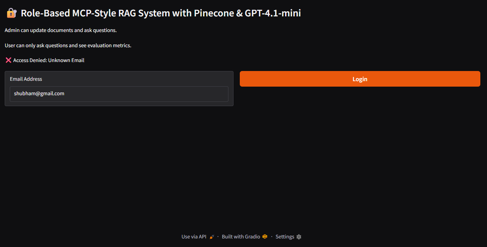
5️⃣ Admin Answer (Policy Q&A)
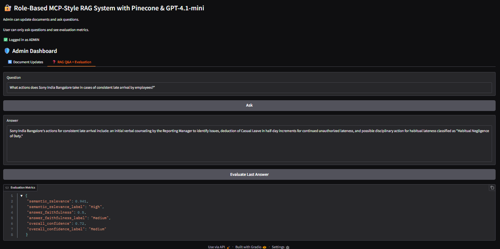
6️⃣ Admin Updates Policy Snippet (Write Path)
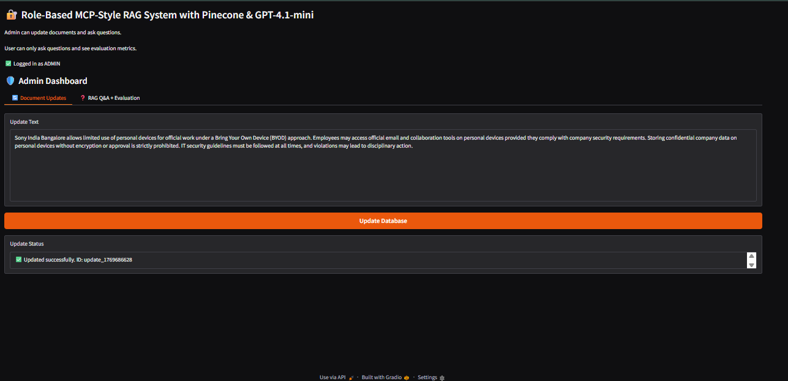
7️⃣ User Retrieves Updated Policy Answer (Post-Update Proof)
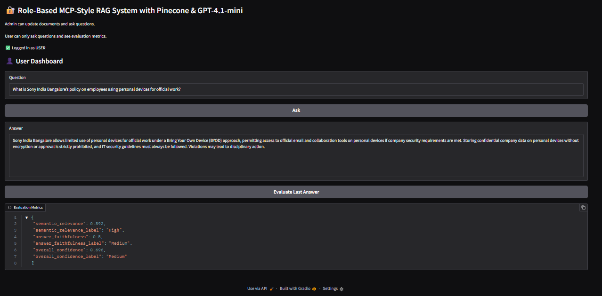
8️⃣ User Answer + Evaluation Metrics Visible
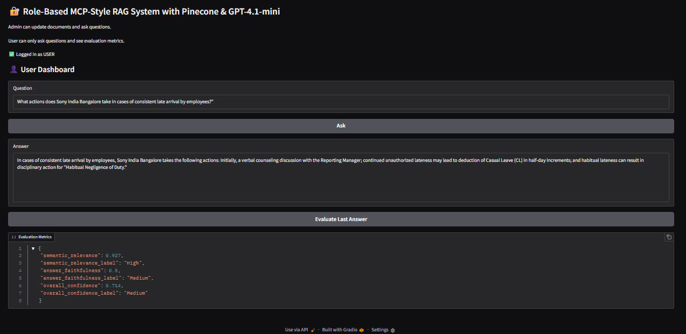
9️⃣ Missing Information Handling (Safe Output)
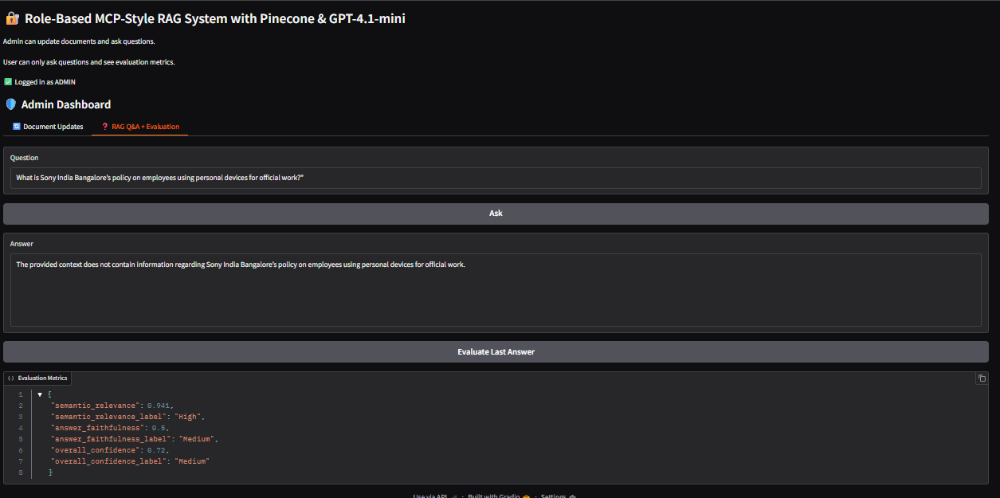
🧪 Step-by-Step Demonstration (MCP-Native RAG)
🔟 MCP-Native Core Interface
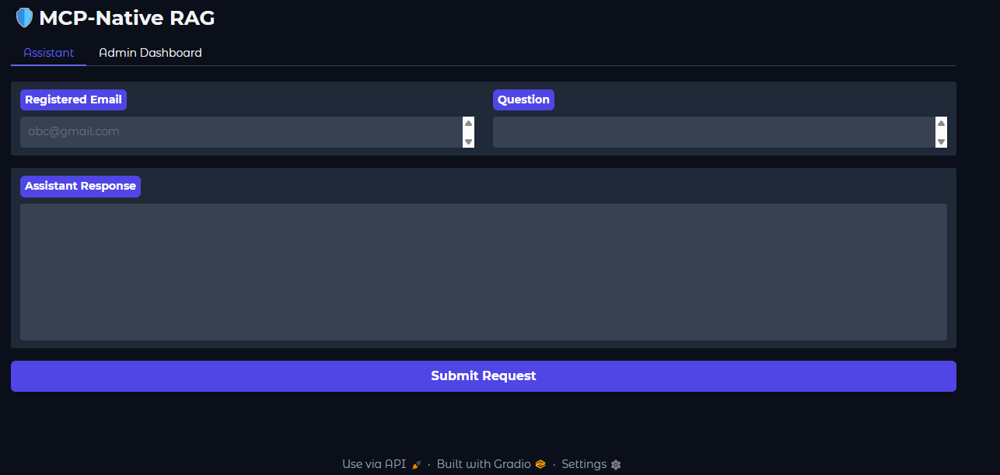
1️⃣1️⃣ MCP-Native: Answer Output (Policy Q&A)
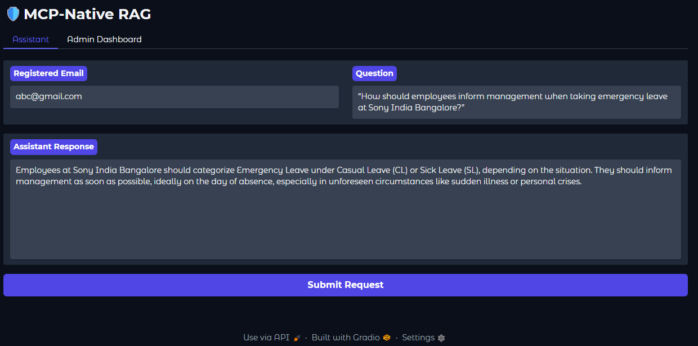
1️⃣2️⃣ MCP-Native: Admin Answer (Evidence of Allowed Access)
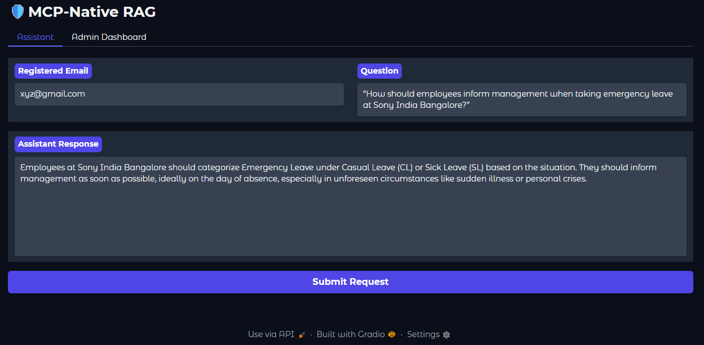
1️⃣3️⃣ MCP-Native: Admin Policy Injection Accepted (Authorized Write)
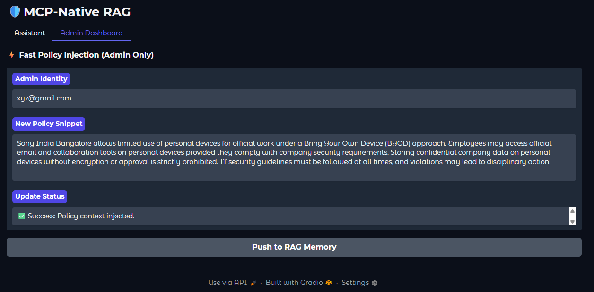
1️⃣4️⃣ MCP-Native: Answer Retrieved After Update (Update → Retrieval Proof)
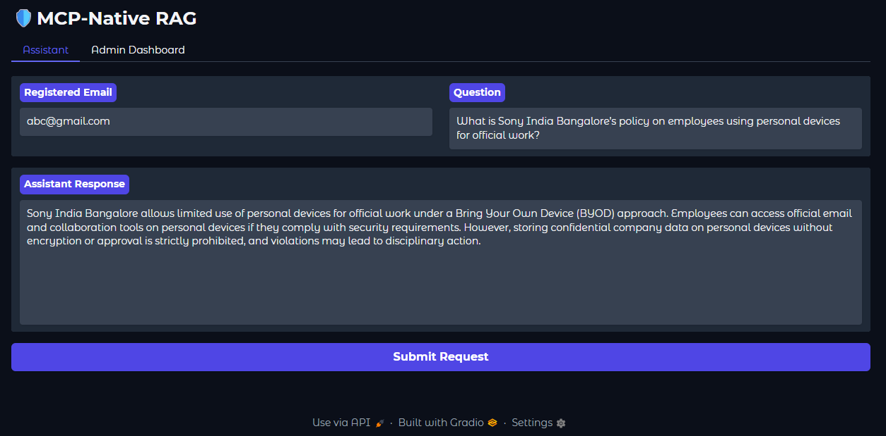
1️⃣5️⃣ MCP-Native: User Answer Output

1️⃣6️⃣ MCP-Native: User Update Blocked (Unauthorized Write Attempt)
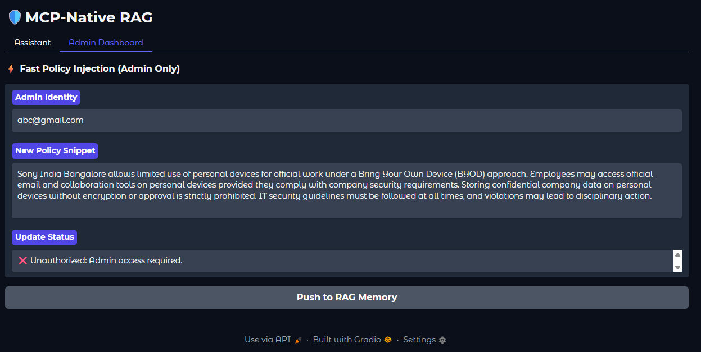
1️⃣7️⃣ MCP-Native: Authorization Check Fail (Tool-Level Enforcement Proof)
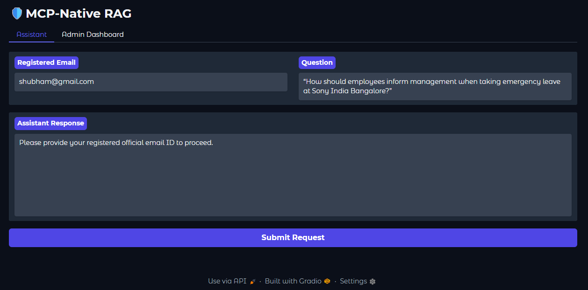
1️⃣8️⃣ MCP-Native: Lack of Information Response (Safe Output)
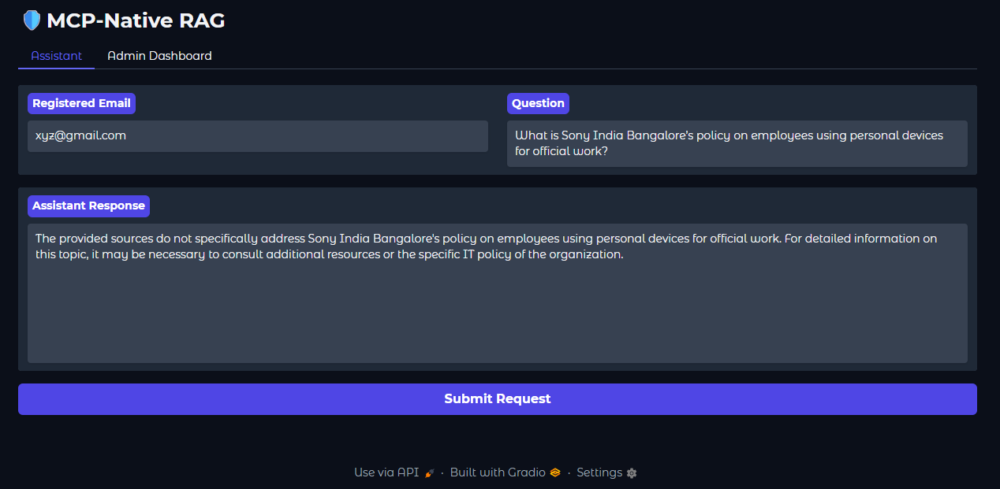
🔍 Comparative Summary
Dimension	MCP-Style RAG	MCP-Native RAG
Authority location	UI / App layer	Tool layer
LLM awareness of auth	Low	High
Tool contracts	Implicit	Explicit
Auditability	Medium	Strong
Multi-agent readiness	Limited	Native
Best use case	Demos, dashboards	Scalable agent systems
⚠️ Limitations & Disclosure

No cross-encoder reranking (direct similarity retrieval)

No persistent server-side memory beyond vector storage

No hidden prompt rewriting

LLM access requires an API key

Screenshots reflect real, unfiltered outputs

▶️ Usage
python mcp_inspired_rag.py
# OR
python mcp_native.py

Then:

Log in as Admin or User

Ask policy questions

Inject policy updates (Admin only)

Observe retrieval correctness and enforcement

🔮 Future Enhancements

Unified MCP-Native + evaluation pipeline

Tool-level audit logs

Multi-agent orchestration

Source citation overlays

Optional reranking layer

API-first deployment (FastAPI)

👨‍💻 Author

Shubham Singh

📜 License

MIT License
