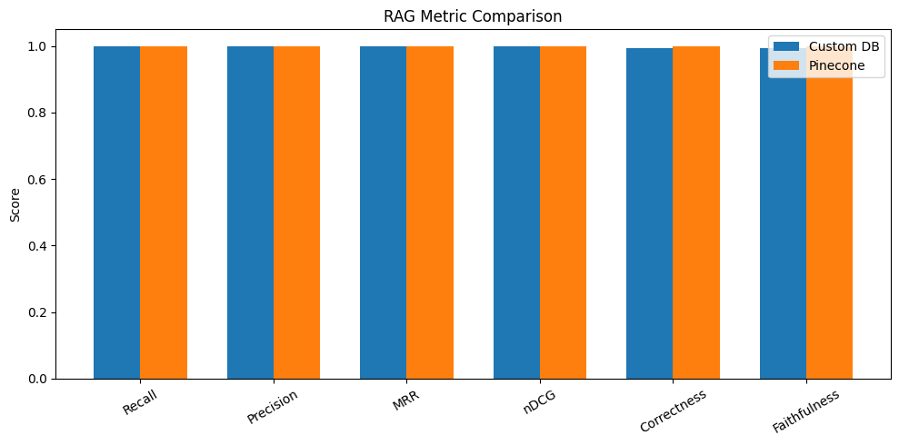
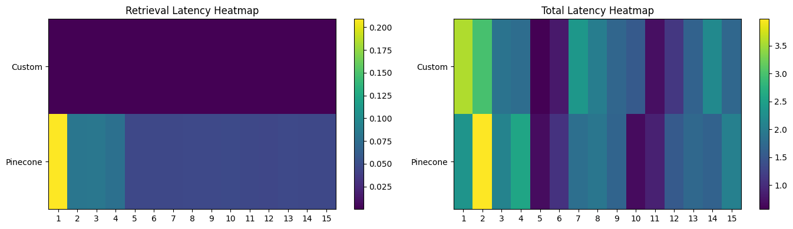
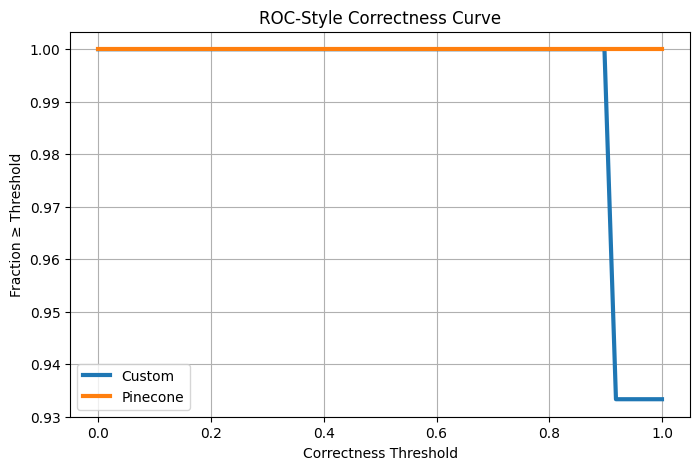

# Local vs Managed Vector Store RAG Benchmark

This project compares a **custom local in-memory vector store** with a **managed vector database (Pinecone)** for a Retrieval-Augmented Generation (RAG) system built on a **small, well-scoped document corpus**.

The core motivation is to demonstrate that **for limited datasets, using an API-based vector database is unnecessary overhead** — a local vector store can deliver **comparable answer quality**, **much lower latency**, and **significantly reduced cost**, which is critical for small startups and internal tools.

---

## 📌 Project Overview

### Objective
To evaluate whether managed vector databases (like Pinecone) provide any meaningful advantage over a **custom local vector store** when:
- Dataset size is small
- Data is static or slowly changing
- Low latency and low cost are priorities

### Dataset
- **Sony Bangalore Office Policy Creation.docx**
- Size: ~6 MB
- Chunked into **11 semantic chunks**

### Systems Compared
1. **Custom Vector Store**
   - In-memory NumPy cosine similarity
   - No external services
   - Zero infra and query cost

2. **Pinecone (Managed Vector DB)**
   - Serverless Pinecone index
   - Network-based retrieval
   - Paid, API-driven infrastructure

---

## ⚙️ RAG Pipeline

1. Upload policy document (`.docx / .pdf / .txt`)
2. Chunk document text
3. Generate embeddings using `BAAI/bge-large-en`
4. Index data into:
   - Custom local vector store
   - Pinecone index
5. Ask policy-related questions
6. Measure retrieval quality and latency

---

## 📊 Evaluation Metrics

- Recall
- Precision
- Mean Reciprocal Rank (MRR)
- nDCG
- Correctness (LLM-evaluated)
- Faithfulness to retrieved context
- Retrieval latency
- Total latency (retrieval + LLM)

---

## 📈 RAG Metric Comparison

Both systems achieve **near-identical retrieval and answer quality** on this dataset.



---

## ⏱ Retrieval Latency Heatmap

The local vector store is **orders of magnitude faster** because it avoids network calls.


---

## ⏱ Total Latency Heatmap

Total latency is dominated by the LLM in both systems.  
Optimizing retrieval beyond a point gives diminishing returns.



---

## 📉 ROC-Style Correctness Curve

This plot shows answer robustness across correctness thresholds.  
Both systems remain stable due to the clean and well-scoped dataset.



---

## 🧠 Key Insight

> **For small, well-scoped datasets, a local in-memory vector store provides retrieval quality comparable to managed vector databases while being dramatically faster and significantly cheaper.**

This makes local vector stores the **right default choice** for:
- Early-stage startups
- Internal enterprise tools
- Policy / compliance assistants
- MVP-stage RAG systems

Using managed vector databases in these scenarios **adds cost without improving outcomes**.

---

## 📂 Project Structure

```text
vectorstore-comparison/
├── custom_pinecone_comparison.py
├── Sony Bangalore Office Policy Creation.docx
├── ragmetric_comparison.png
├── retrival_heatmap.png
├── latency_heatmap.png
├── rocstyle_correctness_curve.png
└── README.md

⚠️ Notes

The dataset is intentionally small to isolate retrieval behavior.

Metrics saturate because questions map directly to specific policy sections.

This repository is an engineering benchmark, not a large-scale IR study.

The document is used strictly for technical demonstration purposes.

👤 Author

Shubham Singh

📜 License

MIT License
